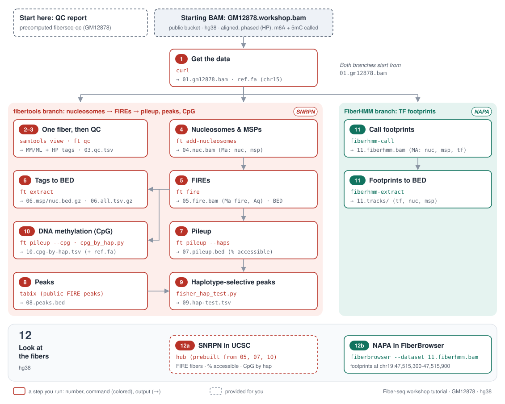

# Fiber-seq hands-on tutorial

Call nucleosomes, MSPs, FIREs and TF footprints on Fiber-seq reads, then view them in the UCSC Genome Browser and FiberBrowser.

**Data:** public GM12878 Fiber-seq (PacBio, hg38) from the Stergachis lab, already aligned and phased,
with m6A and 5mC called. You add everything else.

| Locus (hg38) | Exercise |
|---|---|
| *SNRPN* `chr15:24,850,000-25,050,000` | Imprinted promoter: open on one copy, closed and methylated on the other. |
| *NAPA* `chr19:47,480,000-47,525,000` | TF footprints (e.g. CTCF) on single fibers. |

Each step ends with a **Lost?** line that downloads its outputs so you can catch up.



---

## 0. Setup (before the workshop)

**Windows:** run `wsl --install` in PowerShell (as administrator), restart, then do everything in the
*Ubuntu* app. (Windows on ARM and Chromebooks: use the cluster.)

**1. Check for conda:** `conda --version`

- 23.10 or newer, or on the course cluster (HPCF): go to 2.
- Older: `conda update -n base conda`, then go to 2.
- `command not found`: install it (below), **then open a new terminal**.

```bash
# ONLY if you don't have conda
curl -L -O "https://github.com/conda-forge/miniforge/releases/latest/download/Miniforge3-$(uname)-$(uname -m).sh"
bash Miniforge3-$(uname)-$(uname -m).sh -b
~/miniforge3/bin/conda init "$(basename "$SHELL")"
```

*Have `mamba` or `micromamba` instead? Use it in place of `conda` (run `mamba shell init --shell bash` once if `activate` complains).*

**2. Install the tutorial:**

```bash
git clone https://github.com/christylaflamme/fiber-seq-workshop.git
cd fiber-seq-workshop/tutorial
conda env create -f environment.yml      # ~3 min
conda activate fiberseq-workshop
bash scripts/check_setup.sh               # should end with "ALL PASS"
```

Any FAIL: send the output to the instructors, or use the cluster (same commands).

**On the day:**

```bash
conda activate fiberseq-workshop        # load the tutorial's tools (ft, samtools, fiberhmm, ...)
cd fiber-seq-workshop/tutorial          # the folder you cloned
TUT=$PWD                                # remember it: the scripts/ folder lives here
mkdir -p ~/fiberseq && cd ~/fiberseq    # work here, so outputs stay out of the clone

# Shortcuts used in the commands below
HUB=https://s3.kopah.uw.edu/stergachis/public/FIRE/broadly-consented/GM12878   # public genome-wide FIRE results (peaks, hap-differences)
BUCKET=https://s3.kopah.uw.edu/fiberseq-workshop   # workshop files: starting BAM + "Lost?" catch-up archives
START=$BUCKET/GM12878.workshop.bam      # the starting BAM (aligned, phased, m6A + 5mC called)
SNRPN=chr15:24850000-25050000           # hg38 region 1: imprinted SNRPN promoter
NAPA=chr19:47480000-47525000            # hg38 region 2: NAPA promoter (TF footprints)
```

---

## Start here: the QC report

A precomputed [fiberseq-qc](https://github.com/fiberseq/fiberseq-qc) report for GM12878 (72,566 fibers, ~1.2 Gb of
data, from 80 random 100 kb windows across the autosomes).

👉 **[Open the QC report](../qc/GM12878_report/GM12878.overview.html)** (from your cloned copy), or:

```bash
open $TUT/../qc/GM12878_report/GM12878.overview.html          # Mac (Linux: xdg-open; WSL: explorer.exe)
```

What to check (typical targets for a full sample; GM12878 values from this report):

| Metric | What it tells you | Target | GM12878 |
|---|---|---|---|
| Data yield | ≥ 15X per haplotype (30X total) ≈ 90 Gb for a human genome | > 100 Gb | subset only (~1.2 Gb) |
| Read N50 | roughly the typical read length | > 15 kb | 19.2 kb |
| m6A rate (m6A/AT) | how much methylation; varies by sample and tissue (FIRE handles this range) | 2–12% | 8.5% |
| Chromatin signal-to-noise (CSN) | from the autocorrelation: was chromatin kept intact during the reaction? | > 25 | 54 |
| Absent nucleosomes (MSPs > 400 bp) | chromatin disrupted before stenciling (e.g. apoptosis, autolysis) | < 2.5% | 0.4% |
| Untreated fibers (footprints > 500 bp) | reads that look unmethylated | < 4% | 0.9% |

---

## 1. Get the data

```bash
curl -sSf -o 01.gm12878.bam $START
curl -sSf -o 01.gm12878.bam.bai $START.bai
samtools view -c 01.gm12878.bam             # 2005 fibers
samtools view -c 01.gm12878.bam $SNRPN      # 1644 fibers
samtools view -c 01.gm12878.bam $NAPA       # 361 fibers
curl -sSf https://hgdownload.soe.ucsc.edu/goldenPath/hg38/chromosomes/chr15.fa.gz | gunzip > ref.fa   # for step 10
```

m6A comes from the PacBio instrument on current runs (older data: `ft predict-m6a`).

Lost? `curl -sSf $BUCKET/step01.tar.gz | tar xz`

## 2. Look at one fiber

```bash
samtools view 01.gm12878.bam | head -1 | cut -f 1-9
samtools view 01.gm12878.bam | head -1 | cut -f 12- | tr '\t;' '\n\n' | cut -c 1-80   # tabs and ; become new lines: one tag per line, MM split into C+m, A+a, T-a
```

Find `MM`/`ML` (m6A = `A+a`, `T-a`; 5mC = `C+m`) and `HP` (haplotype). No nucleosomes or FIREs yet.

| Tag | Example | Meaning |
|---|---|---|
| `MM` | `A+a,40,10,3,…` | which bases carry a mod. Numbers are **skip counts** of that base, not positions: skip 40 As → the 41st A; skip 10 more → the 52nd A. `0` = the very next one (a run of `0`s = As in a row). |
| | `C+m` / `A+a` / `T-a` | 5mC on Cs / m6A on this strand's As / m6A on the other strand, at the A across from each T |
| `ML` | `78,56,236,…` | confidence for each `MM` call, in the same order (÷ 256 ≈ probability: 78 ≈ 0.30, 236 ≈ 0.92) |
| `HP` / `PS` | `1` / `1` | haplotype (which parent's copy) / phase block |
| `ec` / `rq` | `5.48` / `0.998` | passes around the molecule / predicted read accuracy (`ccs_passes` and `read_quality` in step 3's `ft qc`) |

`ft extract` (step 6) turns these calls into genome positions for you.

Docs: [`MM`/`ML` spec](https://samtools.github.io/hts-specs/SAMtags.pdf) (section 1.7, base modifications).

## 3. QC

```bash
ft qc 01.gm12878.bam 03.qc.tsv
grep -E '^phased_reads' 03.qc.tsv           # H1 999, H2 915, unphased 91
```

`03.qc.tsv` holds histograms, one `statistic  value  count` row per value, for fiber length, m6A ratio,
CCS passes, read quality and more. Taking the median of each (weighting each value by its count) gives a
median fiber of 16.5 kb, with ~8% of A/T bases carrying m6A.

Docs: [`ft qc`](https://fiberseq.github.io/fibertools/help.html#ft-qc) (output columns: `statistic value count`).

Lost? `curl -sSf $BUCKET/step03.tar.gz | tar xz`

## 4. Nucleosomes and MSPs (per molecule)

```bash
ft add-nucleosomes 01.gm12878.bam 04.nuc.bam
samtools index 04.nuc.bam
samtools view 04.nuc.bam | head -1 | tr '\t' '\n' | grep '^Ma' | tr ';' '\n' | cut -c 1-80
```

Calls go in the new `Ma` tag: `Ma:Z:35208;nuc.:242-101,…;msp.:111-131,…` (read length; then start-length
along the read). Unlike `MM`'s skip counts, these are **absolute positions along the read** (1-based):
`nuc.:242-101` is a nucleosome covering read bases 242–342. FIREs (step 5) are written the same way.

Docs: [`ft add-nucleosomes`](https://fiberseq.github.io/fibertools/creating/nucleosome.html) · [`Ma` tag format](https://github.com/fiberseq/Molecular-annotation-spec).

Lost? `curl -sSf $BUCKET/step04.tar.gz | tar xz`

## 5. FIREs (per molecule)

```bash
ft fire -F 260 --min-msp 10 --min-ave-msp-size 10 --skip-no-m6a 04.nuc.bam 05.fire.bam
samtools index 05.fire.bam
samtools view 05.fire.bam | head -1 | tr '\t' '\n' | grep -E '^(Ma|Aq)' | tr ';' '\n' | cut -c 1-80
ft fire --extract 05.fire.bam 05.fire-elements.bed   # one row per MSP (FIRE or not), with its FDR in column 10
awk '$10<=0.10' 05.fire-elements.bed | wc -l   # 2336 FIREs: MSPs with FDR ≤ 10% (the FIRE pipeline's cutoff)
```

FIREs are MSPs scored as regulatory elements: `fire.Q:5043-143` in `Ma`, score in `Aq`.

| Tag / part | Example | Meaning |
|---|---|---|
| `Ma` | `35208;…` | read length, then one `;`-separated list per feature type |
| `nuc.` / `msp.` | `242-101` | nucleosomes / MSPs: `start-length` along the read (1-based); `.` = not stranded |
| `fire.Q` | `5043-143` | FIREs: read bases 5,043–5,185; `Q` = has a score in `Aq` |
| `Aq` | `244` | one 0–255 score per FIRE, in order (higher = more confident) |

`--extract` converts these read positions to hg38. Older files (and the linked docs) use the legacy tags
`ns/nl`, `as/al`, `aq`; `ft convert-tags` converts them to `Ma`/`Aq`.

The flags are the [FIRE pipeline](https://github.com/fiberseq/FIRE)'s defaults: `-F 260` skips unmapped (4) and
secondary (256) alignments; `--skip-no-m6a`, `--min-msp 10` and `--min-ave-msp-size 10` drop fibers with no
m6A, fewer than 10 MSPs, or an average MSP under 10 bp (likely untreated or noisy).

Docs: [`ft fire`](https://fiberseq.github.io/fibertools/creating/fire.html) · [options incl. `--extract`](https://fiberseq.github.io/fibertools/help.html#ft-fire).

Lost? `curl -sSf $BUCKET/step05.tar.gz | tar xz`

## 6. Tags to BED (per molecule)

```bash
ft extract 05.fire.bam --msp 06.msp.bed.gz --nuc 06.nuc.bed.gz --all 06.all.tsv.gz
gzip -dc 06.msp.bed.gz | head -2 | cut -c 1-150
```

`ft extract` unpacks the BAM tags into plain-text tables. They're much easier to read than the tags, but you still
need to process them before you can interpret them: a starting point for your own analysis.

- **`06.msp.bed.gz` / `06.nuc.bed.gz`** (BED12): one row per **fiber**. Columns 1–3 are where the whole read sits on
  hg38, *not* where the MSPs or nucleosomes are. Those are packed into columns 10–12 as blocks (count, sizes, starts
  relative to the read start); genome browsers draw them as boxes along the fiber.
- **`06.all.tsv.gz`**: one row per read with everything in its own column: m6A, 5mC, nucleosomes, MSPs and FIREs
  (with scores), in read and hg38 (`ref_`) coordinates. The easiest input for R or Python.

Docs: [`ft extract` output columns](https://fiberseq.github.io/fibertools/extracting/extract.html#output-description).

Lost? `curl -sSf $BUCKET/step06.tar.gz | tar xz`

## 7. Pileup (per locus - *SNRPN*)

```bash
ft pileup --haps --fiber-coverage -r $SNRPN -o 07.pileup.bed 05.fire.bam
awk 'NR>1 && $4>0 {f=$5/$4; if(f>m){m=f;l=$0}} END{print m; print l}' 07.pileup.bed   # most open base
```

% accessible = FIRE coverage / coverage. Most open base: *SNRPN* promoter, `chr15:24,956,279`, **47%**
(59/124). By haplotype: **hap1 1/62, hap2 58/62**.

Each row is a stretch of hg38 where none of the counts change (often 1–3 bp). Columns, with the promoter row:

| Columns | Promoter row | Meaning |
|---|---|---|
| `chrom start end` | `chr15 24956278 24956279` | the stretch |
| `coverage` | 124 | fibers covering it |
| `fire_coverage` | 59 | fibers with a FIRE here |
| `nuc_coverage` / `msp_coverage` | 47 / 77 | fibers with a nucleosome / an MSP (FIREs count as MSPs) |
| `score` | 38.7 | FIRE score |
| `…_H1`, `…_H2` | 62, 1, … / 62, 58, … | the same columns for each haplotype |

Docs: [`ft pileup` options](https://fiberseq.github.io/fibertools/help.html#ft-pileup) (options only; the output columns are not documented there).

Lost? `curl -sSf $BUCKET/step07.tar.gz | tar xz`

## 8. Peaks (per locus - *SNRPN* + *NAPA*)

FIRE peaks need a genome-wide FDR, so we take them from the public genome-wide file.

```bash
# on a genome-wide BAM, the analogous ft command is ft call-peaks (or run the FIRE pipeline)
tabix -h $HUB/GM12878-fire-v0.1-peaks.bed.gz $SNRPN $NAPA > 08.peaks.bed
cut -f 1 08.peaks.bed | sort | uniq -c       # 13 on chr15, 26 on chr19
```

Lost? `curl -sSf $BUCKET/step08.tar.gz | tar xz`

## 9. Haplotype-selective peaks (per locus - *SNRPN*)

Is a peak more open on one haplotype than the other? The FIRE pipeline answers this for every peak
genome-wide (its `hap-differences` file). We re-create its test here so you can see what happens in the
background. `fisher_hap_test.py` does, for each *SNRPN* peak:

1. find the peak's summit (the middle of the peak);
2. look up the step 7 pileup row there and read `coverage` and `fire_coverage` for H1 and H2;
3. skip the peak if either haplotype has < 10 fibers;
4. build a 2×2 table (haplotype × FIRE / no FIRE) and run a two-sided Fisher's exact test;
5. sort by p-value and correct for the number of peaks tested (Benjamini-Hochberg, `p_adjust_locus`; the
   FIRE pipeline corrects across all peaks genome-wide, so only its raw p-values match ours).

```bash
python $TUT/scripts/fisher_hap_test.py 07.pileup.bed 08.peaks.bed > 09.hap-test.tsv
column -t 09.hap-test.tsv | cut -c 1-140
awk -F'\t' 'NR>1 && $11 < 0.05' 09.hap-test.tsv | wc -l   # 5 significant (column 11 = p_adjust_locus < 0.05)
```

Top hit: the promoter. Its 2×2 table (fibers at the summit):

| | FIRE | no FIRE | total |
|---|---|---|---|
| **hap1** | 1 | 61 | 62 |
| **hap2** | 58 | 4 | 62 |

2% vs 94% accessible: Fisher's exact test gives **p = 5 × 10⁻²⁹**. All 5 significant peaks are in the promoter. The FIRE
pipeline gets the same counts and p-value, but a larger p-adjust (2 × 10⁻²³ vs our 7 × 10⁻²⁸): it corrects
across ~465,000 peaks genome-wide, we correct across 13 (check: `curl -sSf $HUB/GM12878-fire-v0.1-hap-differences.bed.gz | gunzip | awk -F'\t' '$1=="chr15" && $2==24956234' | cut -f 1-3,38-43`).

Lost? `curl -sSf $BUCKET/step09.tar.gz | tar xz`

## 10. DNA methylation (per locus - *SNRPN*)

The same fibers carry 5mC. `ft pileup --cpg --per-base` counts, at every base, the fibers with a 5mC call
(overall and per haplotype). `cpg_by_hap.py` turns that into **% methylated per CpG**:

1. find each CpG ("CG") in the hg38 sequence (`ref.fa`);
2. add up the methylated fibers on both strands: PacBio reports + strand calls on the C and − strand calls on the G;
3. divide by the fibers covering the CpG, for all fibers, hap1 and hap2.

The `awk` line then averages those percentages over the promoter (the 5 significant peaks from step 9,
`chr15:24,954,860-24,956,892`).

```bash
ft pileup --cpg --haps --fiber-coverage --per-base -r $SNRPN -o 10.cpg.pileup.bed 05.fire.bam
python $TUT/scripts/cpg_by_hap.py 10.cpg.pileup.bed ref.fa > 10.cpg-by-hap.tsv
awk -F'\t' 'NR>1 && $2>=24954860 && $3<=24956892 && $9!="" && $9!="nan" && $12!="" && $12!="nan" {h1+=$9; h2+=$12; n++}
  END {printf "hap1 %.0f%%   hap2 %.0f%%   (mean over %d CpGs)\n", h1/n, h2/n, n}' 10.cpg-by-hap.tsv
```

**hap1 66%, hap2 20%** methylated at the promoter: the closed copy is the methylated one.
(`cpg_by_hap.py` and the promoter mean are our summaries of ft's pileup.)

Lost? `curl -sSf $BUCKET/step10.tar.gz | tar xz`

> **On your own data:** you don't need to run these steps one by one. The [FIRE pipeline](https://github.com/fiberseq/FIRE)
> runs them genome-wide in one go (nucleosomes, FIREs, pileups, peaks with a genome-wide FDR,
> haplotype-selective peaks and a UCSC track hub). We split them up here so you can see what each one does.

## 11. TF footprints (FiberHMM - *NAPA*)

A bound protein leaves a short m6A-free gap: a footprint. FiberHMM calls them on every fiber (from the
starting BAM) but can't tell which protein made them. We can infer what could have been bound there from
analyzing footprint size, binding location, and motif identity.

```bash
fiberhmm-call -i 01.gm12878.bam -o 11.fiberhmm.bam --enzyme hia5 --seq pacbio -c 4 --no-qc   # default Hia5/PacBio model; --no-qc skips FiberHMM's QC report
samtools index 11.fiberhmm.bam
fiberhmm-extract -i 11.fiberhmm.bam -o 11.tracks --tf --nucleosome --msp --bed-only -c 4
```

Footprints go in the `MA`/`AQ` tags with a `tf` type (same format as `Ma`); `fiberhmm-extract` writes them as
BED12 tracks in `11.tracks/` (one row per fiber, like step 6). In step 12b you'll look at them over a known CTCF
motif at the *NAPA* promoter.

Lost? `curl -sSf $BUCKET/step11.tar.gz | tar xz`

## 12. Look at the fibers (*SNRPN* and *NAPA*)

**a. *SNRPN* in UCSC.** 👉 **[Open the *SNRPN* hub in UCSC](https://genome.ucsc.edu/cgi-bin/hgTracks?db=hg38&hubClear=https://s3.kopah.uw.edu/fiberseq-workshop/hub/hub.txt&position=chr15:24954000-24958000)** (hg38, `chr15:24,954,000-24,958,000`)

Same layout as the lab's production hubs:

Tracks top to bottom, as they appear in the browser:

| Track | Track name in UCSC | What it shows |
|---|---|---|
| FIRE percent accessible | `GM12878-FIRE-percent-accessible` | all (black), hap1 (blue), hap2 (red) |
| FIRE FDR | `GM12878-FIRE-FDR` | −10·log10 FDR of the FIRE pileup (the hub labels it `-10log10 FDR`) |
| FIRE peaks | `GM12878-FIRE-peaks` | narrow and wide peaks, hap-differences, unreliable-coverage regions (genome-wide calls) |
| FIRE fibers (H1 / H2 / UNK) | `GM12878-H1-FIRE-fibers`, `-H2-`, `-UNK-` | one row per fiber: red FIREs, purple linkers (5mC, m6A, nucleosomes: track settings) |
| CpG differences | `GM12878-CpG-diffs` | hap1 − hap2 % methylated, from step 10 |
| CpG | `GM12878-CpG-Comb`, `-CpG-H1`, `-CpG-H2` | % methylated (combined, H1, H2), from step 10 |
| FIRE coverage | `GM12878-all-FIRE-coverage` | fibers with a FIRE, linker or nucleosome at each base |

*Tip: right-click a track to open its settings (**Configure**) or to collapse or expand it (**hide**, **dense**, **squish**, **pack**, **full**).*

*Tip: in the % accessible track's **Configure** settings, set **Overlay method** to **none** to stack hap1 and hap2 as separate graphs, or set **Graph type** to **bar** to fill them in.*

At the promoter, hap2 fibers carry FIREs (93.6% accessible) and hap1 fibers don't (1.6%); the CpG tracks
show the opposite. (To add the hub by hand, *My Data → Track Hubs*:
`https://s3.kopah.uw.edu/fiberseq-workshop/hub/hub.txt`.)

**Your own hub:** the [FIRE pipeline](https://github.com/fiberseq/FIRE) builds this hub for you genome-wide
(see its [track hub output](https://fiberseq.github.io/fire/outputs.html#the-trackhub-v-directory)). The fiber
tracks come from [`ft track-decorators`](https://fiberseq.github.io/fibertools/help.html#ft-track-decorators); how
we built this one from the tutorial's steps is in [`hub/README.md`](hub/README.md).

**b. *NAPA* in FiberBrowser** (in `~/fiberseq`):

```bash
fiberbrowser --dataset 11.fiberhmm.bam:FiberHMM
```

It opens in your browser (or paste the `localhost` link it prints; `Ctrl+C` stops it). Pick **hg38**, go to
`chr19:47,515,300-47,515,900` and add motif **JASPAR → CTCF**: a column of footprints sits on the site.
On the cluster? Copy `11.fiberhmm.bam*` to your laptop first.

Then try:

1. **m6A:** toggle it on to see where the m6A marks fall on each fiber, and the gaps footprints leave.
2. **Labeling:** see how footprints are labeled as TFs (by size and position).
3. **Clusters:** cluster fibers by TF footprints to find different states of co-occupancy.
4. **Footprinting:** see which proteins might bind each footprint, from its size and JASPAR motif matches.

More in the [FiberBrowser tutorial](https://github.com/fiberseq/FiberBrowser/blob/main/docs/tutorial.md).

---

## Resources

**Fiber-seq resources**
- fibertools documentation: [github.com/fiberseq/fibertools-rs](https://github.com/fiberseq/fibertools-rs), [fiberseq.github.io](https://fiberseq.github.io/index.html)
- fibertools-FIRE: [github.com/fiberseq/FIRE](https://github.com/fiberseq/FIRE)
- Fiber-seq QC: [github.com/fiberseq/fiberseq-qc](https://github.com/fiberseq/fiberseq-qc)
- Consensus FIRE pipeline: [github.com/StergachisLab/fire_consensus_pipeline](https://github.com/StergachisLab/fire_consensus_pipeline)
- bonFIRE: [github.com/fiberseq/bonFIRE](https://github.com/fiberseq/bonFIRE)
- FiberFold: [github.com/altemoselab/fiberFold](https://github.com/altemoselab/fiberFold)
- FiberHMM: [github.com/fiberseq/FiberHMM](https://github.com/fiberseq/FiberHMM)
- FiberBrowser: [github.com/fiberseq/FiberBrowser](https://github.com/fiberseq/FiberBrowser)

**Bonus technologies/tools from the lab**
- Plasmid Fiber-seq: [github.com/StergachisLab/Plasmid-Fiber-seq](https://github.com/StergachisLab/Plasmid-Fiber-seq)
- DAF-seq: [github.com/StergachisLab/DAF-QC-SMK](https://github.com/StergachisLab/DAF-QC-SMK)
- IsoRanker: [github.com/StergachisLab/IsoRanker](https://github.com/StergachisLab/IsoRanker)

**Papers and data used here**

- Fiber-seq: Stergachis et al., *Science* 2020. [doi:10.1126/science.aaz1646](https://doi.org/10.1126/science.aaz1646)
- fibertools: Jha et al., *Genome Research* 2024. [doi:10.1101/gr.279095.124](https://doi.org/10.1101/gr.279095.124)
- FIRE: Vollger, Swanson et al., *bioRxiv* 2024. [doi:10.1101/2024.06.14.599122](https://doi.org/10.1101/2024.06.14.599122) · [fiberseq.github.io/fire](https://fiberseq.github.io/fire/)
- FiberBrowser: Tullius et al., *bioRxiv* 2026. [doi:10.64898/2026.10.29.762797](https://doi.org/10.64898/2026.10.29.762797)
- DAF-seq (*NAPA*): Swanson et al., *Nature Biotechnology* 2025. [doi:10.1038/s41587-025-02914-3](https://doi.org/10.1038/s41587-025-02914-3)
- FiberFold: Dubocanin et al., *bioRxiv* 2025. [doi:10.1101/2025.02.26.640261](https://doi.org/10.1101/2025.02.26.640261)
- GM12878 data: public FIRE track hub ([hub.txt](https://s3.kopah.uw.edu/stergachis/public/FIRE/broadly-consented/GM12878/trackHub-v0.1/hub.txt)); tracks generated by Mitchell Vollger and Andrew Stergachis
- CTCF motif: JASPAR MA0139.1 · CTCF peak: ENCODE (UCSC `encRegTfbsClustered`)
- Tag spec: [Molecular-annotation-spec](https://github.com/fiberseq/Molecular-annotation-spec)
- Chromatin workshop: [github.com/gabriel-beuchat/CSHL_Chromatin_Workshop_2024](https://github.com/gabriel-beuchat/CSHL_Chromatin_Workshop_2024)

---

*Instructors: how the workshop files were built is in [`scripts/README.md`](scripts/README.md).*
